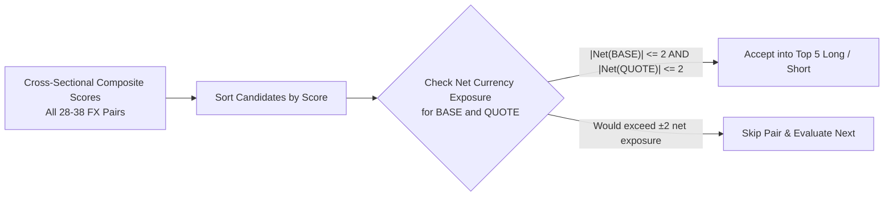

# Bloomberg-Style Multi-Theory FX Swing Screener — Architecture & Implementation Plan

> [!TIP]
> **Executive Verdict: YES — the core architecture transfers strongly to FX.**
> Multi-week swing trend-following (15–20 trading days) combined with cross-sectional ranking, volatility compression breakouts, and regime filtering is one of the best-documented quantitative edges in G10 and EM FX (classic CTA / managed futures alpha). However, **7 structural differences** between NSE F&O equities and decentralized 24/5 Spot FX require targeted adaptations before coding.

---

## 1. NSE F&O vs. FX Market — Side-by-Side Translation Matrix

| Component | Current NSE F&O Implementation | Required FX Adaptation |
| :--- | :--- | :--- |
| **Universe** | ~142 NSE F&O stocks + Nifty / Bank Nifty | **28 G10 FX Pairs** (all crosses of `USD, EUR, GBP, JPY, CHF, CAD, AUD, NZD`) + optional 10–12 liquid EM/Metals (`USD/MXN`, `USD/ZAR`, `USD/SGD`, `USD/INR`, `XAU/USD`, `XAG/USD`) = **28–40 instruments** |
| **Top-N Selection** | Top 10 Long & Top 10 Short (~7% of 142) | **Top 4–5 Long & Top 4–5 Short** (~12–15% of 28–40). Picking Top 10 out of 28 would select 71% of the universe and destroy alpha. |
| **Diversification Cap** | Max 2 stocks per NSE Sector (Banking, IT, etc.) | **Net Currency Exposure Cap:** Max **±2 net legs per single currency** (e.g. prevents going Long `EUR/USD`, `GBP/USD`, `AUD/USD`, `NZD/USD` simultaneously — which is just one 4x Short-USD bet). |
| **Volume / Market Profile (Pillar 2)** | Exchange share volume (`RVOL`, `CMF_20`, `UDVR_20`, `VDU`, Volume Profile) | **Spot FX has no centralized volume.** Replace with **TPO Market Profile (Time-Price Opportunity)** + **Broker Tick Volume** (or **CME FX Futures Volume + CFTC COT** positioning) + **London/NY Session Value Areas**. |
| **Market Hours & Daily Close** | 09:15–15:30 IST; 3:20 PM IST EOD snapshot; `75M` bars | **24/5 continuous market** (Sun 17:00 NY – Fri 17:00 NY). Standardize all daily bars to **17:00 New York (EST/EDT)** institutional rollover. Timeframes: `1D (NY Close)`, `4H`, `1H`, `15M` (drop NSE-specific `75M`). |
| **Macro Regime & Benchmark** | Nifty 50, Bank Nifty, India VIX, Breadth >50D | **DXY (US Dollar Index)**, **AUD/JPY** (Risk-On/Off proxy), **VIX / MOVE / FX CVIX** (volatility stress), and **G10 Currency Strength Basket** (replaces Mansfield RS vs Nifty). |
| **Holding Costs & Catalysts** | NSE Futures slippage/STT (~25 bps round-trip) | Tighter entry spreads (**0.5–3 bps** G10), **PLUS mandatory overnight Carry/Swap modeling** (including **3x Wednesday swap**) and **Tier-1 Macro Calendar Blackout** (FOMC, NFP, CPI, ECB, BoJ, BoE). |
| **Broker / Live Data API** | HDFC Securities InvestRight + Yahoo fallback | **OANDA v20 REST/Stream API** (recommended for rapid build), **Interactive Brokers (IBKR)**, **MT5 Python API**, or **cTrader Open API**. |

---

## 2. Universe & Currency Exposure Governance

### 2.1 Recommended Universe (38 Instruments)
- **Tier 1 — 7 G10 Majors (Tightest spreads, 0.5–1.5 bps):**
  `EUR/USD`, `USD/JPY`, `GBP/USD`, `USD/CHF`, `AUD/USD`, `USD/CAD`, `NZD/USD`
- **Tier 2 — 21 G10 Crosses (High trend persistence, 1.5–3.5 bps):**
  `EUR/JPY`, `GBP/JPY`, `AUD/JPY`, `NZD/JPY`, `CAD/JPY`, `CHF/JPY`, `EUR/GBP`, `EUR/AUD`, `EUR/NZD`, `EUR/CAD`, `EUR/CHF`, `GBP/AUD`, `GBP/NZD`, `GBP/CAD`, `GBP/CHF`, `AUD/NZD`, `AUD/CAD`, `AUD/CHF`, `NZD/CAD`, `NZD/CHF`, `CAD/CHF`
- **Tier 3 — Optional Liquid EM & Precious Metals (10 instruments):**
  `USD/MXN`, `USD/ZAR`, `USD/SGD`, `USD/INR`, `USD/NOK`, `USD/SEK`, `USD/PLN`, `EUR/NOK`, `XAU/USD` (Gold), `XAG/USD` (Silver)

### 2.2 Currency Exposure Matrix (Replaces Sector Cap)
Every FX trade `BASE/QUOTE` carries `+1` unit of `BASE` and `-1` unit of `QUOTE` (for Long) or `-1` `BASE` and `+1` `QUOTE` (for Short).



- **Hard Rule:** No single currency (`USD`, `EUR`, `JPY`, `GBP`, `AUD`, `NZD`, `CAD`, `CHF`) may exceed **±2 net directional positions** across the combined Top-N Long & Short portfolio.
- **Bonus Capability (F2 Tab Enhancement):** Compute a **Currency Strength Index (CSI)** by averaging the composite scores of all pairs containing each currency — giving an instant Bloomberg-style 8-currency strength heatmap (`JPY`, `USD`, `EUR`, `GBP`, `CHF`, `CAD`, `AUD`, `NZD`).

---

## 3. Pillar-by-Pillar Quantitative Adaptation (15–20 Day Swing Horizon)

### Pillar 1 — Trend-Following & Breakout (`40%` Weight)
*Transfers almost 1:1 — and our newly added fast indicators (`DX(14)`, `CHOP(14)`, `RAVI`, `VHF(14)`) are especially effective in FX.*

1. **Structural Donchian Breakout + SuperTrend(10, 3.0):**
   - Keep **20-day Donchian** (Long) / **20-day Donchian** (Short — unlike equities, FX is symmetric; shorts do not crash asymmetrically faster than longs, so use symmetric `20d/20d` instead of `20d/15d`).
   - Keep SuperTrend(10, 3.0) and EMA(50) alignment.
2. **Volatility Compression-to-Expansion (TTM Squeeze + VCP):**
   - Keep Bollinger(20, 2.0) inside Keltner(20, 1.5x ATR20) squeeze detection and `ATR(5)/ATR(50)` contraction ratio.
   - Replace equity share `RVOL` with **Tick-Volume RVOL** (current bar tick count / 20-day median tick count) or **True Range Expansion** (`(H-L)/ATR14`).
3. **Breakout Quality & Anti-Exhaustion:**
   - Keep **CLV** (Close Location Value) and **Extension Z-Score** (`(Close - EMA20) / ATR14`).
   - **Modify `GapATR`:** Since FX is 24/5, daily open gaps are near zero except Sunday open. Keep `GapATR` solely as a Sunday-open weekend-shock filter (`> 1.5 ATR` weekend gap penalty).
4. **High-Sensitivity Early Trend Strength (`DX(14)` + `CHOP(14)` + `RAVI` + `VHF(14)`):**
   - **`DX(14)` + `DI` Spread (30%):** Keep exact formula — catches central-bank / macro breakouts on bar 1.
   - **`CHOP(14)` (30%):** Keep exact Dreiss formula (`< 38.2` linear trend, `> 61.8` chop). FX is notorious for range-bound periods; CHOP drop velocity (`-d_chop2`) is a top breakout filter.
   - **`RAVI(7, 65)` (25%):** **Calibrate for FX volatility.** G10 FX daily ATR is ~0.5%–0.8% (vs 2%–3% for NSE F&O stocks). Lower the RAVI trend threshold from `0.30%` to **`0.15%`–`0.20%`** and scale the normalization cap from `3.5%` to **`1.5%`**.
   - **`VHF(14)` (15%):** Keep exact Adam White formula (`0..1`).
5. **Relative Strength (Replaces Mansfield RS vs Nifty 50):**
   - Replace `Stock / Nifty50` with **Pair Return vs. G10 Equal-Weighted Basket** (or `CSI(BASE) - CSI(QUOTE)` over 20d and 63d).

---

### Pillar 2 — Market Profile & Institutional Flow (`30%` Weight)
*This pillar requires the biggest adaptation because Spot FX has no centralized exchange volume.*

1. **TPO Market Profile (`VAH`, `VAL`, `POC` — Zero Volume Required):**
   - Build Steidlmayer's original **Time-Price Opportunity (TPO)** profile over rolling **20-day** and **60-day** windows using **1H (or 30M) bars**:
     - Discretize the 20d/60d price range into 24–32 bins.
     - Count how many **1H bars traded through each price bin** (time spent at price = institutional acceptance).
     - `POC` = bin with maximum time count; `VAH / VAL` = 70% value area around `POC`.
   - Score **Initiative Breakout above VAH (Long)** / **below VAL (Short)** identical to our equity logic.
2. **Tick-Volume Proxy + CME FX Futures Volume (Hybrid):**
   - Use broker **Tick Volume** (`RVOL_tick`, `UDVR_tick_20`, `CMF_tick_20`). Academic studies show major ECN/broker tick volume correlates ~0.85–0.92 with actual interbank traded volume in G10 pairs.
   - **Optional Pro Upgrade:** Pull daily volume & Open Interest from **CME FX Futures** (`6E` EUR, `6J` JPY, `6B` GBP, `6A` AUD, `6C` CAD, `6S` CHF, `6N` NZD, `6M` MXN) and weekly **CFTC COT Net Speculative Positioning** (free from CFTC API) to measure true institutional accumulation/distribution (Wyckoff SOS/SOW).
3. **Dual Causal Anchored VWAP (or Anchored TWAP):**
   - Anchor to the 60-day Swing Low and 60-day Swing High using **Tick-Volume VWAP** (or **TWAP** — Time-Weighted Average Price if volume is unavailable).

---

### Pillar 3 — Elliott Wave & Momentum Acceleration (`30%` Weight)
*Transfers 100% cleanly to FX — FX is one of the cleanest Elliott Wave markets due to deep liquidity and minimal single-stock idiosyncratic gaps.*

- **Causal ATR-ZigZag (`2.5x ATR14`):** Detects Wave 1–2–3 impulse structures (`W2` retracement `38.2%–61.8%` of `W1`, `1.618x` Fib extension target).
- **ATR-Normalized Elliott Wave Oscillator (`EWO 5–35`):** `(SMA5 - SMA35) / ATR14`.
- **2nd-Derivative MACD Histogram (`Δ²H`) & ROC Acceleration:** Catches momentum inflection before price breaks structure.
- **Constance Brown RSI(14) Regimes:** Bullish support (`40–80`), Bearish resistance (`20–60`).

---

### Pillar 4 / Overlay — Carry (Interest Rate Differential) & Macro Event Filter (FX-Specific)

1. **Carry / Swap Tilt (`±5` to `±10` score adjustment or tie-breaker):**
   - Over a 15–20 day swing hold, positive carry acts as a tailwind and negative carry acts as a drag.
   - Fetch broker financing/swap rates (or 2Y sovereign yield spread: `Yield_2Y(BASE) - Yield_2Y(QUOTE)`).
   - Compute `Net_Carry_20d_bps`: penalize setups where 20-day negative swap exceeds `0.25 * ATR(20)`, and lightly reward positive-carry trend breakouts.
2. **Economic Calendar Blackout Filter:**
   - Integrate a free economic calendar feed (ForexFactory / TradingEconomics / Finnhub).
   - Flag pairs with **Tier-1 Red-Folder Events** (`FOMC`, `NFP`, `US CPI`, `ECB`, `BoJ`, `BoE`, `RBA`, `RBNZ`, `BoC`) within the next **2 hours** as `MACRO_EVENT_RISK` (optional hard block on new entries 60 min pre-event to avoid whipsaw stop-outs).

---

## 4. FX Macro Regime Engine (Replaces Nifty / India VIX Regime)

| Regime State | FX Market Condition | Portfolio Tilt |
| :--- | :--- | :--- |
| **`RISK_ON_TRENDING`** | `AUD/JPY > SMA50`, `VIX < 18`, `FX CVIX < 8.5`, avg `CHOP(14) < 48` | Full risk budget; favor pro-cyclical/carry trends (`AUD`, `NZD`, `GBP`, `MXN` longs; `JPY`, `CHF` shorts) |
| **`USD_DOMINANT_TREND`** | `DXY` breakout (`DX14 > 30`, `CHOP14 < 42`) | Allow up to 2 net USD legs; tighten stops on counter-USD crosses |
| **`RISK_OFF_STRESS`** | `AUD/JPY < SMA50` AND (`VIX > 24` OR `MOVE > 120`) | Favor safe-haven inflows (`JPY`, `CHF`, `USD`, `XAU/USD` longs); cut position size by 30–50% |
| **`RANGE_CHOP`** | Universe median `CHOP(14) > 58` AND median `VHF(14) < 0.25` | Reduce allocation / raise minimum composite score threshold to avoid breakout whipsaws |

---

## 5. Risk Management, Position Sizing & F4 Paper-Trade Lifecycle

### 5.1 Volatility-Normalized Pip Position Sizing
Unlike equities (where `Shares = Risk / (Entry - Stop)`), FX pairs have different quote currencies and pip sizes (`0.01` for `JPY` pairs, `0.0001` for non-JPY pairs):

$$\text{Position Size (Units)} = \frac{\text{Account Equity} \times \text{Risk\%}}{|\text{Entry} - \text{Stop}| \times \text{Quote-to-Account Conversion Rate}}$$

- **Initial Stop:** `2.0x ATR(20)` from entry price.
- **Target:** `min(3.5x ATR(20), Wave-3 1.618x Fib Target)` for Longs (symmetric for Shorts).
- **Chandelier Trailing Stop:** Activates at `+1.0R` (`Peak - 2.5x ATR(20)` for Longs; `Trough + 2.5x ATR(20)` for Shorts).
- **F4 Paper-Trade & Archive Lifecycle:**
  - Exact same rule as our NSE F&O terminal: when a pair enters Top-N and flashes (`★ NEW` for 5 minutes), lock its exact live entry price into `data/fx_trade_journal.json`, track live 1s MTM% (including accrued daily swap/carry!), and move to `data/fx_trade_archive.json` **only when Take Profit (`TARGET_HIT`) or Stop Loss (`STOP_HIT`) is reached**.

---

## 6. Data, Scheduling & Technical Architecture

### 6.1 Recommended Data & Broker Stack
| Option | Live 1s Stream | Historical NY-Close Candles | Swap / Carry Rates | Best For |
| :--- | :--- | :--- | :--- | :--- |
| **OANDA v20 API** *(Recommended)* | Free streaming API (practice + live) | Native `NY 17:00` aligned `D`, `H4`, `H1`, `M15` | Available via Instruments API | Fastest, cleanest Python REST/SSE setup (closest to our current architecture) |
| **MetaTrader 5 (`MetaTrader5` Python pkg)** | Direct tick stream from any MT5 broker | Broker OHLC + Tick Volume | Native swap long/short | If you already trade with an MT5 FX broker |
| **Interactive Brokers (`ib_insync`)** | Real-time IDEALPRO quotes | Historical FX + CME FX Futures volume | Available | Institutional execution + true CME futures volume |
| **TwelveData / Polygon.io + yfinance** | WebSocket / REST | Daily & Intraday | Manual / FRED 2Y yields | Read-only screener without a broker account |

### 6.2 24/5 Recalculation & Snapshot Schedule (Replacing 09:15–15:30 IST)
- **Live Price Stream:** Continuous **1-second** stream (with 5-consecutive-failure guard before any fallback feed).
- **Continuous Re-Ranking:** Every **5 minutes** during active London + NY sessions (`07:00–17:00 NY` / `16:30–02:30 IST`), and every 15 minutes during Asian session.
- **Key Institutional Snapshots (Replaces 3:20 PM IST EOD):**
  - **London Open Snapshot (`08:00 London`)**
  - **NY Open / Overlap Snapshot (`08:30 New York`)**
  - **Pre-Rollover NY Close Snapshot (`16:50 New York`)** — treats 16:50 NY live price as EOD so positions can be placed right before the 17:00 NY daily candle close and rollover!

### 6.3 Recommended Repository Structure for the New FX Project
```text
fx-bloomberg-screener/
├── auth_or_config.py          # OANDA / IBKR / MT5 API credentials (.env)
├── fx_client.py               # Read-only live quote stream + NY-close candle fetcher
├── fx_universe.py             # 28 G10 + EM/Metals specs (pip_size, base, quote, tier)
├── fx_market_data.py          # Gap-aware NY-close parquet cache + 1H TPO cache
├── fx_regime.py               # DXY, AUD/JPY, VIX/MOVE, Universe CHOP regime engine
├── fx_calendar.py             # Tier-1 macro event blackout checker
├── pillars/
│   ├── trend_breakout.py      # Donchian, SuperTrend, VCP, DX(14)/CHOP(14)/RAVI/VHF(14)
│   ├── market_profile_tpo.py  # TPO Value Area (VAH/VAL/POC) + Tick-Vol/COT flow
│   └── elliott_momentum.py    # Causal ATR-ZigZag W1-2-3, EWO, MACD-H Δ², RSI regimes
├── fx_ranking_engine.py       # Rank-Gauss, Löwdin, Carry tilt, ±2 Currency Exposure Cap
├── fx_trade_journal.py        # Fixed-entry F4 tracker + TP/SL auto-archive + swap P&L
├── fx_backtest.py             # Purged Walk-Forward backtest (spreads + overnight carry)
├── stream_server.py           # Port 8889 (avoids 8888), 0.0.0.0 LAN + Cloudflare tunnel
└── ui/
    ├── index.html             # Bloomberg Terminal UI (F1 Top 5 L/S, F2 Universe + CSI Heatmap + In-Tab Chart, F3 WFO, F4 Journal/Archive)
    ├── terminal.js            # TradingView Log-Scale Charts (no gridlines), 5m NEW flash
    └── fullscreen.html
```

---

## 7. Purged Walk-Forward Backtesting & Validation Protocol

Before trading live, run `fx_backtest.py` over **5–10 years of NY-Close daily data** with:
1. **Zero-Lookahead Causality Tests** (shocking final bar `t` must not alter signals at `t-1` across all 3 pillars).
2. **Realistic Cost Model:**
   - Entry/Exit Half-Spread + Slippage: `1.0 bp` (Tier 1 Majors), `2.5 bps` (Tier 2 Crosses), `6.0 bps` (Tier 3 EM).
   - **Carry/Swap Modeling:** Accrue daily interest rate differential over the exact holding days (`+` or `-` bps/day).
   - Stress-test at **2x spread**.
3. **Target Validation Metrics:**
   - 15–20d Forward Rank IC `> 0.04` (ICIR `> 0.45`)
   - Combined Long/Short Purged WFO Sharpe `> 1.0` net of spread & carry
   - Monotonic Decile/Quintile spread (Top Quintile minus Bottom Quintile positive and statistically significant)
   - Max Pillar Correlation `|ρ| < 0.50` (enforced via Löwdin orthogonalization)

---

## 8. Phased Build Roadmap for Your New FX Project

1. **Phase 1 — Data & Broker Connectivity:** Connect `fx_client.py` (OANDA v20 or MT5/IBKR) with NY-Close (`17:00 EST/EDT`) historical parquet sync + 1-second live streaming + pip/swap metadata.
2. **Phase 2 — Quantitative Engine:** Port `pillars/trend_breakout.py` (with FX-calibrated RAVI + symmetric 20d Donchian), build `pillars/market_profile_tpo.py` (TPO + Tick Volume), port `pillars/elliott_momentum.py`, and implement `fx_ranking_engine.py` with the **±2 Net Currency Exposure Cap** and **Currency Strength Index**.
3. **Phase 3 — Validation:** Run purged walk-forward backtest (`fx_backtest.py`) with spread + carry modeling and verify causality & Sharpe ratio.
4. **Phase 4 — Bloomberg Terminal UI & F4 Archive:** Port `stream_server.py` and `ui/` (Log-scale TradingView charts, F1 Top 5 L/S, F2 Universe + Currency Strength Heatmap + in-tab chart, F3 WFO telemetry, F4 fixed-entry Paper Trade + TP/SL Archive, LAN/Cloudflare sharing).
